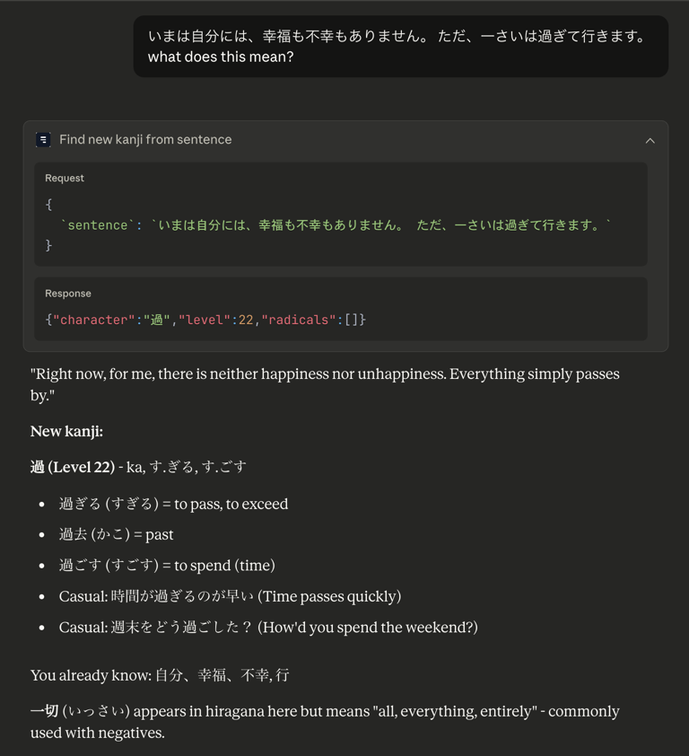
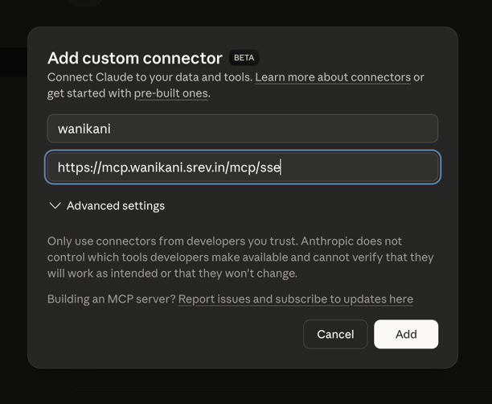

# wanikani-mcp
[MCP](https://modelcontextprotocol.io/docs/getting-started/intro) server for [wanikani](https://www.wanikani.com/).



## Setup
Get your API key from https://www.wanikani.com/settings/personal_access_tokens.
Do not grant any write permissions (leave all boxes unchecked).

### Docker
```json
{
  "mcpServers": {
    "wanikani": {
      "command": "docker",
      "args": [
        "run", "-i", "--rm", "ghcr.io/srevinsaju/wanikani-mcp:main",
        "--mode", "stdio",
        "--api-key", "YOUR_WANIKANI_API_KEY"
      ]
    }
  }
}
```

### Local
Build the binary from a clone (see [Building](#building)): the views in `ui/` are embedded at compile time and not checked in, so `cargo install --git` cannot build it.

```json
{
  "mcpServers": {
    "wanikani": {
      "command": "/path/to/wanikani-mcp/target/release/wanikani-mcp",
      "args": ["--mode", "stdio", "--api-key", "YOUR_WANIKANI_API_KEY"]
    }
  }
}
```

### Remote server

On Claude, go to `Settings > Connectors`, add a custom connector with the server's `/mcp` URL (`https://<your-host>/mcp`), and sign in by pasting your API key when asked.



This should also work on Claude Mobile, and with any MCP client that supports remote servers with OAuth: the server supports Dynamic Client Registration, so there is nothing to configure.

## Tools

- `get_level_info` - get level information
- `get_subject_by_id` - get subject by its subject id
- `get_kanji_by_character` - get kanji with readings, mnemonics, and radicals
- `get_vocabulary_by_phrase` - get vocabulary with readings, mnemonics, and example sentences
- `find_new_kanji_from_sentence` - find new kanji from a sentence that user hasn't learned
- `find_new_vocabulary` - find new vocabulary from a list of phrases that user hasn't learned

Hosts that support [MCP Apps](https://github.com/modelcontextprotocol/ext-apps) show each result in a view from [`ui/`](ui): `ui://wanikani/subject`, `ui://wanikani/subjects` and `ui://wanikani/progress`.

## Authentication

In `sse` mode (the default) the server is its own OAuth 2.1 authorization server for `/mcp`. Signing in asks for a WaniKani API key, which is sealed with `VAULT_KEY` and stored in the SQLite database; the client only ever holds an access token and a refresh token. `/mcp` is stateless: every request is served with the API key of the token it carries.

In `stdio` mode the API key is passed directly with `--api-key` (or `WANIKANI_API_KEY`).

## Building

The MCP Apps views in [`ui/`](ui) are embedded into the binary at compile time, so build them before `cargo build`:

```bash
nix develop            # Rust, Bun and the rest of the toolchain
cd ui && bun install --frozen-lockfile && bun run build && cd ..
cargo build --release --locked
```

The [`Dockerfile`](Dockerfile) does both:

```bash
docker build -t wanikani-mcp .
```

## Self-hosting

The server is one binary: the MCP endpoint at `/mcp`, the OAuth endpoints, a setup page at `/`, and `/health`. It keeps its state in one SQLite file, so run a single instance.

| Variable | Flag | Value |
|---|---|---|
| `VAULT_KEY` | `--vault-key` | 32 bytes in base64, from `openssl rand -base64 32`. Required in `sse` mode. Changing it signs everyone out. |
| `PUBLIC_ADDRESS` | `--public-address` | where clients reach the server, e.g. `https://wanikani.example.com`. Default `http://127.0.0.1:3000`. |
| `BIND_ADDRESS` | `--bind-address` | default `127.0.0.1:3000`; `0.0.0.0:8080` in the image. |
| `DATABASE` | `--database` | default `sqlite://wanikani-mcp.db`; `sqlite:///data/wanikani-mcp.db` in the image. |
| `TOKEN_EXPIRATION` | `--token-expiration` | access token lifetime in seconds, default `3600`. Refresh tokens rotate on use. |
| `MODE` | `--mode` | `sse` (default) or `stdio`. |
| `WANIKANI_API_KEY` | `--api-key` | the API key, in `stdio` mode only. |
| `RUST_LOG` | | log filter; `wanikani_mcp=info` in the image. |

The image runs as uid/gid `10001` and writes only to `/data` (the database and its `-wal`/`-shm` files), so the root filesystem can be read-only. `/data` must be writable by uid `10001`.

```bash
docker volume create wanikani-mcp
docker run --rm -p 8080:8080 \
  -v wanikani-mcp:/data \
  -e VAULT_KEY="$(openssl rand -base64 32)" \
  -e PUBLIC_ADDRESS=http://localhost:8080 \
  wanikani-mcp
```

Keep the `VAULT_KEY` you generate: a new one on the next start signs everyone out.

## license

MIT
